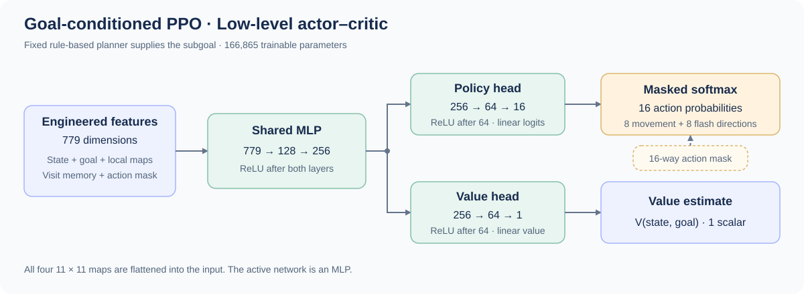

# 1st Place, Preliminary Round — 2025 Tencent Kaiwu AI Competition

**Agent Decision Algorithms · Intermediate Track · Back to the Realm v2**

This is the solution writeup for my **1st-place result in the preliminary round** of the 2025 Tencent Kaiwu Global AI Competition, Intermediate Track (2025 腾讯开悟人工智能全球公开赛【智能体算法决策-中级赛道】). The preliminary-round task was *Back to the Realm* (重返秘境). See the [official track description](https://tencentarena.com/aiarena/zh/match/open-competition-2025/open-competition-2025-1).

Thank you to the competition organizers for providing the challenge, simulation environment, and training framework.

> **Repository scope:** this repository preserves the agent source and explains the solution. Running it requires the **Tencent Kaiwu Docker environment supplied for the competition**, including its game runtime, agent interfaces, and training services. The repository does not include that environment or trained model weights.

## Overview

My solution separates route decisions from local movement:

- A **rule-based high-level planner** selects a treasure, an intermediate waypoint, the speed buff, or the exit as the current subgoal.
- A **goal-conditioned PPO policy** chooses individual movement and flash actions to reach that subgoal.
- **Engineered state features and explicit visitation memory** give a small feedforward network information about local geometry, task progress, and previously visited locations.
- **Reward shaping and action masking** express the priorities of collecting treasures, finishing the task, avoiding repeated movement, and using flash selectively.

The resulting architecture is a form of **hierarchical control with a fixed high-level policy and a learned low-level policy**. The hierarchy is designed manually; reinforcement learning trains the movement controller. The Actor–Critic network has **779 input features, 16 discrete actions, and 166,865 parameters**.

## Competition Understanding

The task combines navigation and collection under a limited time budget. The agent must reach the exit while collecting as many treasures as possible, using a local field of view, a flash skill, and a speed buff. This creates three connected problems:

1. **Choosing the next destination.** The nearest treasure in Euclidean distance is not always the most convenient destination given the map's corridors and walls.
2. **Reaching that destination.** Local movement must account for obstacles, flash availability, and changing observations.
3. **Remembering previous behavior.** Local observations alone do not distinguish useful exploration from repeatedly walking through the same area.

The design gives each problem an explicit place in the system. Route rules handle destination selection, PPO handles movement, and a visitation map supplies memory. This concentrates learning on a reusable question: **how should I move toward the current goal from this state?**

## Hierarchical Design

### High Level: Rule-Based Subgoal Selection

The high-level policy is implemented in [`Preprocessor`](code/agent_diy/feature/preprocessor.py), primarily in `get_target()`, with additional target-switching logic in `pb2struct()`. It uses the current position, remembered route state, treasure availability, and exit information to select a subgoal:

$$
g_t=f_{\mathrm{rules}}(s_t,m_t).
$$

Here, $m_t$ includes route flags and visitation memory. The rule set starts from the nearest available treasure and applies map-specific overrides:

- **Intermediate waypoints:** routes can insert a coordinate that is useful for navigating between regions. For example, one branch routes through $(100,52)$ after $(101,28)$ when a particular treasure is unavailable, then redirects toward $(80,50)$.
- **Regional route state:** the planner remembers information observed at selected locations and uses it to choose subsequent waypoints or exit approaches.
- **Exit scheduling:** after the remaining-treasure state indicates that collection is complete, the rules select the exit or an intermediate point on the way to it.
- **Recovery behavior:** concentrated revisits near the agent can redirect it toward the buff location. This is a hand-designed escape mechanism, not a learned subgoal policy.

A subgoal normally persists until the agent reaches its coordinate neighborhood. It can also be interrupted by recovery logic or local target-visibility rules. Thus, high-level decisions operate over multiple low-level steps rather than prescribing a fixed sequence of directional commands.

### Low Level: Goal-Conditioned PPO

The low-level policy receives the selected subgoal as part of its observation and samples one primitive action:

$$
a_t\sim\pi_\theta(a\mid\phi(s_t,g_t,m_t)).
$$

There are **eight movement directions and eight flash directions**. After every environment step, the observation is processed again and the policy makes another decision. The same policy is used for treasure collection, waypoint navigation, buff navigation, and exit navigation.

Only $\theta$ is optimized by PPO. There is no learned manager selecting subgoal IDs and no PPO action that means “complete the entire route to treasure A.” This distinction matters when describing the method: it is **rule-guided hierarchical reinforcement learning**, with learning at the lower level, rather than joint learning of both levels. Temporal abstraction and hierarchical policies are discussed in the [Options framework](https://www.sciencedirect.com/science/article/pii/S0004370299000521).

## Model Architecture



The network is a compact **shared-trunk Actor–Critic MLP**:

| Component | Dimensions | Output |
| --- | --- | --- |
| Shared trunk | $779\rightarrow128\rightarrow256$ | Shared state–goal representation |
| Policy head | $256\rightarrow64\rightarrow16$ | Action logits |
| Value head | $256\rightarrow64\rightarrow1$ | State–goal value estimate |

ReLU follows both trunk layers and the first layer of each head. The final layers of the two heads are linear. Linear weights use orthogonal initialization and biases start at zero.

Before softmax, disallowed action logits receive a large negative offset. The policy then samples from the resulting distribution. The archived `exploit()` implementation also samples actions; it does not switch to greedy argmax evaluation.

The local maps are **flattened inputs to the MLP**. The active model has no CNN, RNN, or attention module. Memory is maintained explicitly by preprocessing. `NetworkModelActor` and `NetworkModelLearner` are inference/training wrappers around this same architecture; they are not the high and low levels of the hierarchy.

Source: [`model/model.py`](code/agent_diy/model/model.py), [`agent.py`](code/agent_diy/agent.py).

## Feature Construction

The feature vector contains **779 values**, in the order defined by [`Config.FEATURES`](code/agent_diy/conf/conf.py):

| Feature group | Dimensions | Meaning |
| --- | ---: | --- |
| Current position | 2 | Normalized current $x,z$ coordinates |
| Current subgoal | 6 | Flag, relative direction, target coordinates, distance |
| Exit | 6 | Discovery flag and the same position encoding |
| Historical position | 6 | Position encoding for the oldest location in a rolling window of up to 10 observations |
| Action mask | 16 | Allowed movement and flash directions |
| Collected treasure count | 1 | Raw `treasure_collected_count` |
| Buff availability | 1 | Buff object's status |
| Target-in-view flag | 1 | Coordinate-window test for the selected treasure or exit: within ±5 on both axes |
| Local obstacle map | 121 | Flattened $11\times11$ binary map |
| Local exit map | 121 | Flattened $11\times11$ binary map |
| Local treasure map | 121 | Flattened $11\times11$ binary map |
| Local visitation memory | 121 | An $11\times11$ crop of the global visitation map |
| Current-coordinate one-hot vectors | 256 | Separate 128-way encodings of current $x$ and $z$ |
| **Total** | **779** | **39 scalar features + 484 map values + 256 one-hot values** |

### Position and Goal Encoding

Each six-dimensional position feature contains a flag, two normalized unit-direction components, two normalized target coordinates, and a normalized Euclidean distance. Coordinates use the implementation's clipped $[-128,128]$ normalization range; direction components use $[-1,1]$, and distances are scaled by $1.41\times128$.

The flag is fixed to 1 for ordinary subgoals and the historical position. For the exit, it records whether the exact location has been discovered. This discovery flag is distinct from the coordinate-window test used for `target_in_view`.

When the exit is the current goal, its feature vector occupies both the goal slot and the exit slot. Before the exact exit is discovered, the code estimates its position from the provided direction and coarse distance category, using `distance_category × 20` and the corresponding compass angle. In the retained implementation, this estimate is initialized and refreshed every 100 steps until the exact position becomes available.

Two names in the source comments can be misleading: the treasure-count feature measures **collected**, rather than remaining, treasures; the coordinate one-hot vectors encode the **agent's current location**, rather than the target location.

### Explicit Visitation Memory

A $128\times128$ array records visits during each episode. Visiting a cell updates it as:

$$
M[z,x]\leftarrow\min(1.2,M[z,x]+0.1).
$$

The implementation flips the world $z$ coordinate when indexing this array, then extracts an $11\times11$ neighborhood around the agent. Memory resets between episodes and has no decay within an episode. It stores **visit intensity**, not a reconstructed global obstacle map.

This memory enters the policy input, contributes to a repeated-visit penalty, and triggers the rule-based recovery behavior. It gives a feedforward controller access to some movement history without requiring a recurrent network.

### Action Masking

The mask combines skill readiness with map-specific constraints. Flash is disabled initially and while unavailable; when ready, it is considered only in directions with an adjacent wall and outside explicitly excluded coordinate regions. This encodes a preference for selected wall-crossing opportunities rather than unrestricted flash use.

While the current goal is not the exit, the rules also suppress ordinary movement directions whose nearby cells contain the exit. These restrictions are task-specific priors. They do not constitute a general collision-free path planner.

## Reward Design

The reward connects local movement to the high-level route. Its main priorities are progress toward the selected target, completion after collection, efficient movement, and selective flash use.

### Progress Toward the Current Target

For a target $g$, define squared distances before and after a transition and the progress magnitude:

$$
D_{\mathrm{pre}}(g)=\|p_{\mathrm{pre}}-g\|_2^2,\qquad
D_{\mathrm{cur}}(g)=\|p_{\mathrm{cur}}-g\|_2^2,
$$

$$
q(g)=\sqrt{|D_{\mathrm{pre}}(g)-D_{\mathrm{cur}}(g)|}.
$$

The code rewards decreasing squared distance and penalizes increasing squared distance. It uses $q(g)$, **not the direct difference between Euclidean distances**.

| Target and visibility | Approaching | Moving away | Additional per-step offset |
| --- | ---: | ---: | ---: |
| Exit, visible | $+0.50625q(g)$ | $-0.50625q(g)$ | $-0.05$ |
| Exit, not visible | $+0.1125q(g)$ | $-0.12375q(g)$ | $-0.01$ |
| Other target, visible | $+0.1125q(g)$ | $-0.16875q(g)$ | $0$ |
| Other target, not visible | $+0.1125q(g)$ | $-0.12375q(g)$ | $0$ |

The larger exit coefficient applies when the goal has been identified locally. For non-exit targets, the penalty for moving away is stronger than the reward for an equally sized approach.

### Events and Movement Costs

| Component | Implemented reward |
| --- | --- |
| Step cost | $-0.01$ on each non-initial shaped step, in addition to the offsets above |
| Score increase while pursuing the exit | $+1$ |
| Score increase while pursuing another target | $+0.5$, only when within 3 units of the selected target on both axes |
| Flash use | Normally $-0.6$; reduced to $-0.35$ in six recognized dynamic-obstacle crossing regions |
| Detected wall collision | $-0.02$, with an additional $-0.3$ if flash was used |
| Repeated visits | $-0.005\sum\max(M_{\mathrm{local}}[3{:}8,3{:}8]-0.8,0)$ |

Flash use is inferred from a change in the environment's skill-availability flag. Collisions are inferred from low displacement near a wall. The dynamic-obstacle identifier adjusts flash cost; it is not a learned obstacle classifier or an input that directly selects the high-level route.

Two further terms are retained in the source:

- **Avoiding an early exit:** when pursuing another goal within 3 units of a discovered exit on both axes, moving closer to the exit incurs $-0.025q(e)$ and moving away earns $+0.025q(e)$.
- **Historical-position shaping:** a small term rewards approaching the oldest position in the recent history window and penalizes moving away, with magnitude $0.01q(h)$. This is the actual sign in the archived code; the separate visitation-memory term supplies the explicit repeated-visit penalty.

### Episode Completion

The final reward is:

$$
F=
\begin{cases}
-3, & \text{if the environment reports truncation},\\
5-5N_{\mathrm{remaining}}, & \text{if the environment reports termination}.
\end{cases}
$$

The remaining-treasure count is read from the latest preprocessed state. Finishing with no remaining treasures gives $+5$; one remaining treasure gives $0$; larger counts are penalized. This couples successful navigation to the collection objective.

In this implementation, the final transition receives $F$ **instead of an additional terminal-state dense reward**. The workflow does not preprocess the terminal observation again. A separate development step-limit cutoff leaves $F=0$ if neither environment flag is set.

Source: [`feature/definition.py`](code/agent_diy/feature/definition.py), [`workflow/train_workflow.py`](code/agent_diy/workflow/train_workflow.py).

## PPO Training

The policy uses the clipped surrogate objective from [PPO](https://arxiv.org/abs/1707.06347), together with value regression and entropy regularization. With the probability ratio $\rho_t=\pi_\theta(a_t\mid s_t,g_t)/\pi_{\mathrm{old}}(a_t\mid s_t,g_t)$, the policy loss is:

$$
L_\pi=-\mathbb{E}\left[\min\left(\rho_t\hat A_t,
\mathrm{clip}(\rho_t,1-\epsilon,1+\epsilon)\hat A_t\right)\right].
$$

Advantages are computed backward over each collected episode using [Generalized Advantage Estimation](https://arxiv.org/abs/1506.02438):

$$
\delta_t=r_{t+1}+\gamma V_{t+1}-V_t,\qquad
\hat A_t=\delta_t+\gamma\lambda\hat A_{t+1},\qquad
\hat R_t=\hat A_t+V_t.
$$

| Setting | Retained value |
| --- | ---: |
| Discount $\gamma$ | 0.99 |
| GAE $\lambda$ | 0.95 |
| Learning rate | $3\times10^{-4}$ |
| PPO clip $\epsilon$ | 0.2 |
| Value-loss coefficient | 1 |
| Entropy coefficient | $5\times10^{-4}$ |
| Optimizer | Adam, $\beta=(0.9,0.999)$, $\epsilon=10^{-8}$ |
| Gradient-norm clipping | 0.5 |

Each local `learn()` call performs one optimizer step on the supplied batch. Batch scheduling and sample delivery belong to the Kaiwu runtime. The source does not contain an additional PPO epoch loop or advantage normalization.

The saved environment configuration uses a $128\times128$ map, start $(38,55)$, exit $(25,30)$, buff $(57,68)$, eight fixed treasure positions, randomized dynamic obstacles, and a maximum of 2,000 steps. Flash and buff cooldowns are both 100 steps. These are the settings in the retained training configuration, not a claim that every competition evaluation used those settings.

<details>
<summary>Implementation details relevant to reproducing the archived behavior</summary>

- Dense rewards are calculated while processing the next observation; the sample manager consequently uses `reward[i + 1]` for GAE. The initial shaped reward does not enter the advantages. The terminal reward enters GAE but is not included in the packed raw-reward column.
- The terminal value is set to zero for all ending conditions, including truncation. The code does not bootstrap through time-limit truncations.
- Goal selection happens before reward shaping. At a goal switch, progress is measured relative to the newly selected goal.
- The value-loss implementation squeezes the new value prediction to shape `[B]`, while sampled old values and returns remain `[B, 1]`. For batches larger than one, the subsequent arithmetic broadcasts across samples. This behavior is present in the retained source; it should be checked before adapting the loss as a standard per-sample clipped value loss.
- The failed-movement blacklist depends on `last_action`, which remains `-1` along the retained agent path. It is therefore not an active mechanism in the workflow described here.
- `model/n_step_buffer.py` and the separate `env/` helper classes are included in the archived source but are not used by the active PPO workflow.

</details>

## Design Trade-offs

The solution puts much of the task knowledge into **goal selection, features, rewards, and masks**, while keeping the neural network small. The high-level route is interpretable, and the learned controller can respond to local observations while pursuing each selected target. Explicit memory supplies information that a feedforward policy would otherwise lose between observations.

This also defines the method's limits. The route rules and flash restrictions encode coordinates from this map, so they should not be treated as a general navigation algorithm. Transferring the agent to another map would require revisiting those priors. A learned high-level goal selector or a graph-based planner would be possible extensions; neither is implemented here.

The reported result is **1st place in the preliminary round**. This writeup explains the retained solution; it does not attribute numerical gains to individual components, because controlled ablation results are not included with the source.

## Code Guide and Runtime Requirements

```text
code/agent_diy/
├── agent.py                      # Observation, action, inference, and model interfaces
├── algorithm/algorithm.py        # PPO optimization
├── conf/conf.py                  # Features, dimensions, and learning parameters
├── conf/train_env_conf.toml      # Saved environment configuration
├── feature/preprocessor.py       # High-level rules, state features, memory, masks
├── feature/definition.py         # Reward shaping, episode samples, GAE
├── feature/constants.py          # Direction-related constants
├── model/model.py                # Shared Actor–Critic MLP
├── model/n_step_buffer.py        # Auxiliary buffer, unused by the PPO workflow
├── workflow/train_workflow.py    # Environment interaction and episode collection
└── env/                         # Auxiliary map utilities
```

The agent imports competition-provided modules such as `kaiwu_agent`, `tools.train_env_conf_validate`, and `tools.metrics_utils`, in addition to PyTorch and NumPy. The game environment and training integration are supplied by the organizer's Docker setup. Installing ordinary Python packages alone does not provide those services.


## References

- [2025 Tencent Kaiwu AI Competition — Intermediate Track](https://tencentarena.com/aiarena/zh/match/open-competition-2025/open-competition-2025-1).
- Schulman et al. [Proximal Policy Optimization Algorithms](https://arxiv.org/abs/1707.06347), 2017.
- Schulman et al. [High-Dimensional Continuous Control Using Generalized Advantage Estimation](https://arxiv.org/abs/1506.02438), ICLR 2016.
- Sutton, Precup, and Singh. [Between MDPs and Semi-MDPs: A Framework for Temporal Abstraction in Reinforcement Learning](https://www.sciencedirect.com/science/article/pii/S0004370299000521), 1999.
